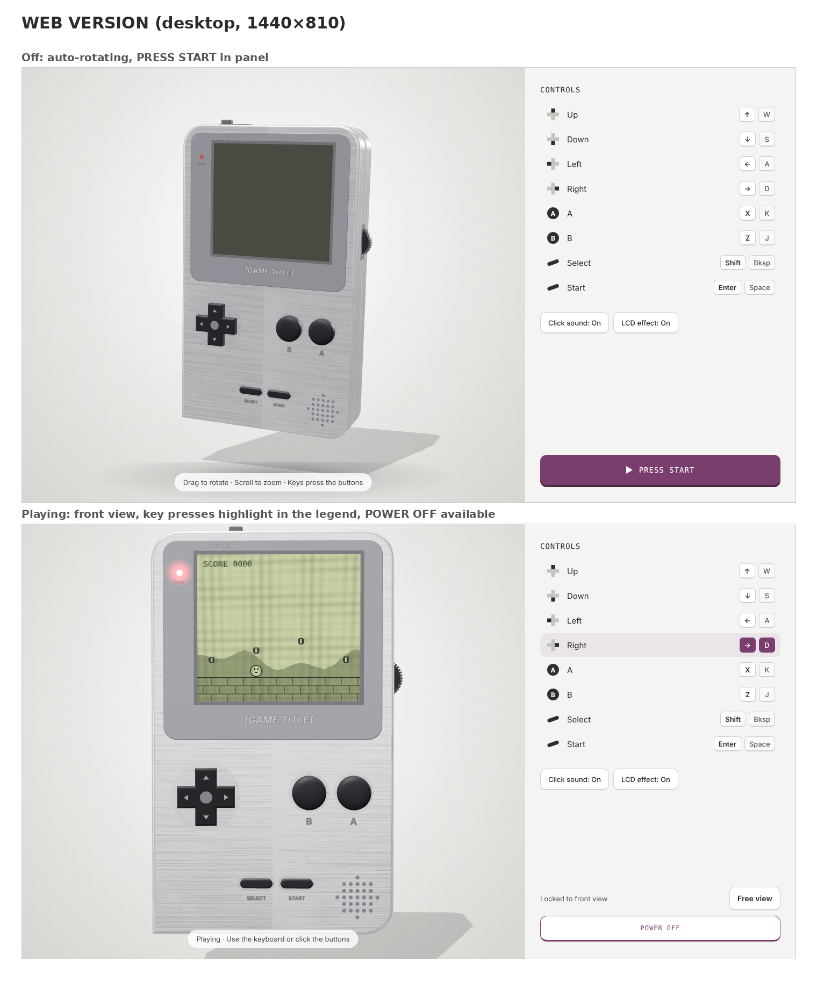
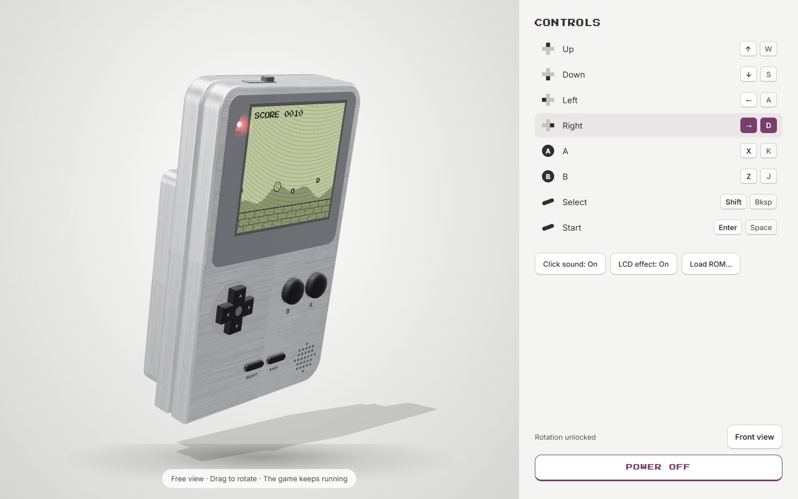

# Handheld Player

A 3D handheld console in your browser, with a built-in Game Boy emulator. Spin it around, press START, and play a ROM file you own. It also runs on phones, and any browser game can be plugged in as the cartridge.

**[▶ Play it online](https://economyofscale.github.io/handheld-player/)** · no install, no sign-up



> **No games are included.** This repository contains no Nintendo software, no ROMs and no boot ROM. Without a ROM the player runs a small built-in demo game; to play something else you load your own `.gb` file. It never leaves your browser: it is read locally and not uploaded anywhere.

## Try it

1. Open the **[online version](https://economyofscale.github.io/handheld-player/)**, or run it yourself (see below).
2. Press **PRESS START** in the side panel.
3. You see the demo game (a blob collecting coins). To play a ROM, do one of these:
   - press **SELECT** on the demo's title screen,
   - click **Load ROM…** in the side panel, or
   - drag a `.gb` file onto the page.

### Controls

| Button | Keys |
|---|---|
| D-pad | Arrow keys or W A S D |
| A | X or K |
| B | Z or J |
| Select | Shift or Backspace |
| Start | Enter or Space |

You can also click the buttons on the device or in the side panel. Drag to rotate the device, scroll to zoom. On a phone the touch version opens automatically (add `?desktop` to the address to stay on the desktop page).

### Free view: turn the device while you play



When you power on, the device turns to face you and stays locked to the front, so dragging over the screen can't knock it sideways mid-game. Click **Free view** at the bottom of the side panel to unlock it:

- **Drag** anywhere on the stage to turn the device in any direction. If you let go while still moving, it keeps spinning briefly and slows to a stop.
- **Scroll** to zoom in or out (pinch on a phone).
- **The game keeps running.** The LCD is part of the 3D model, so the picture stays on the screen at every angle, with the LCD effect, and the keys and buttons still work. In the screenshot the player is still running right; the side panel shows the held key.
- Click **Front view** to bring the device back to the front at playing zoom, locked again. **POWER OFF** also ends free view.

## Run it yourself

No build step and no dependencies. The emulator loads as ES modules, so serve the folder over http instead of opening `index.html` from disk.

- **Windows:** double-click `Player.bat`. It starts a small local server (PowerShell only, nothing to install) and opens the page.
- **Anywhere:** `npx serve .` or `python -m http.server`, then open the address it prints.

## What the emulator does

Written from scratch for this project (`game/gb/`), about 1,100 lines of plain JavaScript.

| Part | Covered |
|---|---|
| CPU | All SM83 opcodes, interrupts, HALT (with its bug), the EI delay. Passes Blargg's `cpu_instrs` test ROMs. |
| Graphics | Background, window, sprites (8×8 and 8×16, priority, flips), the LCD modes, STAT and LYC interrupts. Lines are drawn as the hardware reaches them, so scroll effects work. |
| Sound | Two square channels (with sweep), wave, noise, envelopes, length counters, stereo mix, through Web Audio. |
| Cartridges | No mapper, MBC1, MBC2, MBC3 (with real-time clock), MBC5. Battery saves are kept in your browser, per game. |
| Other | Timer, joypad, OAM DMA, serial output capture. |

**Not covered:** Game Boy Color-only games (dual-mode games play in grey), link cable, rumble, the Game Boy Camera, and cycle-exact timing tricks, so a few timing-sensitive games may glitch.

## Put your own game in it

The device is separate from the game. `game/game.js` is a small contract (`attachGame` returns `start`, `update`, `onInput`, `stop`), so you can swap in any canvas game. See **[docs/INTEGRATION.md](docs/INTEGRATION.md)** for the contract, recipes for engines, customising the device, the phone and Android/iOS apps (Capacitor), and deployment.

## Repository layout

```
index.html, mobile.html    desktop page (device + side panel) and phone page
handheld.js                the 3D device: model, power sequence, buttons, LCD effect
style.css, mobile.css, ui.js, ui-mobile.js
game/game.js               the cartridge: loads ROMs, runs the emulator, sound, saves
game/demo.js               the built-in demo game, shown while no ROM is loaded
game/gb/                   the emulator: cpu.js ppu.js apu.js cart.js gb.js
three.min.js               Three.js (MIT), see THIRD_PARTY_NOTICES.md
Player.bat, serve.ps1      one-click local server for Windows
docs/                      integration guide, preview images
.github/workflows/         publishes the online version to GitHub Pages
```

## Publishing your own online copy

The workflow in `.github/workflows/pages.yml` deploys the site to GitHub Pages on every push to `main`:

1. Push this repository to GitHub.
2. In **Settings → Pages**, set **Source** to **GitHub Actions**.
3. After the first run (see the **Actions** tab) the site is at `https://<your-user>.github.io/<repo>/`.
4. Replace `YOUR-USERNAME` in this README (and the repo name, if different) with yours.

## Legal

- The code in this repository is released under the **MIT License** (see [LICENSE](LICENSE)). Third-party parts are listed in [THIRD_PARTY_NOTICES.md](THIRD_PARTY_NOTICES.md).
- This is an independent hobby project. It is **not affiliated with, endorsed by or sponsored by Nintendo**. "Game Boy" and related names are trademarks of Nintendo; they are used here only to describe what the emulator is compatible with.
- The emulator is original code based on publicly documented hardware behaviour. It does not use Nintendo's code or boot ROM.
- Only load ROMs you own or have the right to use, such as homebrew or games you dumped from your own cartridges. Please don't open issues or pull requests that ask for or link to copyrighted ROMs.
